# Store Wallets, Paystack Recipients & Payouts Implementation Plan

> **Status:** Draft / Ready for Review & Feedback  
> **Target Version:** Beembai Seller Portal 1.0  
> **Document Location:** `STORE_WALLET_IMPLEMENTATION_PLAN.md`  
> **Scope:** Store Wallets Data Model, Paystack Transfer Recipients, Escrow/Delivery Fund Releases, Seller Payouts, and Seller UI (`/sell/wallet`).

---

## 1. Executive Summary & Objectives

This document outlines the end-to-end design and implementation plan for adding **Store Wallets** and **Automated Payouts** to Beembai.

### Primary Goals:
1. **Automated Wallet & Recipient Provisioning:**
   - When a store is approved by an administrator, automatically create a wallet for the store.
   - Automatically register the store's verified bank details as a `transfer_recipient` on Paystack, persisting the generated `recipient_code` for future withdrawals.
   - When a store owner updates their banking credentials in `/sell/settings`, update or re-generate their Paystack `recipient_code`.
2. **Two-Tier Balance Architecture:**
   - **`balance` (Total / Ledger Balance):** Credited immediately when a customer pays for an order (funds held in escrow).
   - **`availableBalance` (Available for Withdrawal):** Released and topped up only after the item is confirmed as **delivered** to the customer.
3. **Automated Payouts via Paystack Transfer:**
   - Allow merchants to withdraw from their `availableBalance` directly to their bank account using Paystack's Transfer API.
4. **Dedicated Merchant Financial Portal:**
   - A new dashboard page at `/sell/wallet` with real-time balance statistics, bank account status, withdrawal modal, and detailed transaction audit logs.

<!-- User Comment Space: Executive Summary -->
<!-- Feel free to add notes, adjustments, or high-level feedback here -->

---

## 2. Fund Lifecycle & System Flow

```mermaid
sequenceDiagram
    autonumber
    actor Admin
    actor Buyer
    actor Seller
    participant Convex as Convex Backend
    participant Paystack as Paystack API
    participant GIGL as GIGL / Logistics

    %% Section 1: Store Approval & Recipient Creation
    rect rgb(35, 45, 30)
    Note over Admin, Convex: 1. Store Approval & Wallet Setup
    Admin->>Convex: Approve Store (approveStore)
    Convex->>Convex: Provision `storeWallets` (balance: 0, availableBalance: 0)
    Convex->>Paystack: POST /transferrecipient (account_number, bank_code, name)
    Paystack-->>Convex: Return recipient_code (e.g. RCP_xxxx)
    Convex->>Convex: Save recipient_code to Store & Wallet records
    end

    %% Section 2: Order Placed & Paid
    rect rgb(30, 40, 50)
    Note over Buyer, Convex: 2. Buyer Places & Pays for Order
    Buyer->>Convex: Pay for Order (Paystack charge/inline verification)
    Convex->>Convex: Mark order paid
    Convex->>Convex: Credit store wallet `balance` (+subtotal)
    Convex->>Convex: Insert transaction (type: "order_credit", status: "pending")
    Note right of Convex: `availableBalance` remains unchanged (in escrow)
    end

    %% Section 3: Delivery Confirmation
    rect rgb(45, 40, 30)
    Note over GIGL, Convex: 3. Delivery Confirmation
    GIGL-->>Convex: Package Delivered / Seller or Admin marks "delivered"
    Convex->>Convex: Move funds: Credit `availableBalance` (+subtotal)
    Convex->>Convex: Mark transaction status: "completed" (cleared)
    Convex->>Convex: Flag order `isFundsReleased: true`
    end

    %% Section 4: Merchant Withdrawal
    rect rgb(40, 30, 45)
    Note over Seller, Paystack: 4. Merchant Withdrawal
    Seller->>Convex: Request Payout (amount <= availableBalance)
    Convex->>Convex: Deduct `amount` from `availableBalance` & `balance`
    Convex->>Paystack: POST /transfer (recipient_code, amount, reference)
    Paystack-->>Convex: Transfer queued / accepted
    Convex->>Convex: Insert transaction (type: "withdrawal", status: "completed")
    end
```



<!-- User Comment Space: Fund Lifecycle -->
<!-- Add any comments or adjustments to the sequence of events here -->

---

## 3. Database Schema Design (`convex/schema.ts`)

### A. New Table: `storeWallets`
Manages the current balance and Paystack recipient profile for each store.

```typescript
storeWallets: defineTable({
  storeId: v.id("stores"),
  balance: v.number(),             // Total ledger balance (in NGN, includes escrow)
  availableBalance: v.number(),    // Cleared balance eligible for immediate payout
  recipientCode: v.optional(v.string()), // Paystack transfer recipient code (e.g., "RCP_xxxx")
  currency: v.string(),            // Default: "NGN"
  createdAt: v.number(),
  updatedAt: v.number(),
}).index("by_storeId", ["storeId"]),
```

### B. New Table: `walletTransactions`
Complete ledger recording every movement of money with full idempotency and auditing.

```typescript
walletTransactions: defineTable({
  walletId: v.id("storeWallets"),
  storeId: v.id("stores"),
  amount: v.number(),              // In NGN
  type: v.union(
    v.literal("order_credit"),     // Credit on customer order placement
    v.literal("withdrawal"),       // Debit on payout to merchant bank account
    v.literal("refund"),           // Debit if order was cancelled/refunded
    v.literal("adjustment")        // Manual or admin correction
  ),
  status: v.union(
    v.literal("pending"),          // Held in escrow (undelivered) or payout processing
    v.literal("completed"),        // Funds cleared (delivered) or payout successful
    v.literal("failed"),           // Transfer rejected / failed (funds restored)
    v.literal("reversed")          // Refunded
  ),
  orderId: v.optional(v.id("orders")),
  description: v.string(),         // e.g., "Earnings for Order #BMB-10492"
  paystackTransferCode: v.optional(v.string()), // e.g., "TRF_xxx"
  paystackReference: v.optional(v.string()),
  fee: v.optional(v.number()),     // Transfer processing fee (if applicable)
  createdAt: v.number(),
})
  .index("by_walletId", ["walletId"])
  .index("by_storeId", ["storeId"])
  .index("by_orderId", ["orderId"])
  .index("by_storeId_and_type", ["storeId", "type"]),
```

### C. Updates to Existing Tables
1. **`stores` Table:**
   - Add `recipientCode: v.optional(v.string())` for fast lookup and display on settings.
2. **`orders` Table:**
   - Add `isWalletCredited: v.optional(v.boolean())` (prevents duplicate crediting on webhooks or multiple payment confirmations).
   - Add `isFundsReleased: v.optional(v.boolean())` (prevents double-releasing funds if delivery status is updated multiple times).

<!-- User Comment Space: Schema Design -->
<!-- Add comments on schema fields, types, or indexes here -->

---

## 4. Backend Implementation (`convex/`)

### A. New Module: `convex/wallets.ts`
Centralizes all wallet operations, queries, mutations, and actions.

1. **Queries:**
   - `getStoreWallet(storeId)`: Returns wallet balances (`balance`, `availableBalance`, `recipientCode`) for the given store. Validates that caller owns the store or is admin.
   - `getWalletTransactions(storeId, paginationOpts, typeFilter)`: Returns paginated transactions with filter support (all, credits, withdrawals).
   - `getSellerWalletsOverview()`: Aggregates balances across all stores owned by the current seller.

2. **Internal Mutations (Safe & Atomic):**
   - `ensureWalletExists(storeId)`: Creates wallet document if not already existing.
   - `creditStoreWalletOnOrder({ storeId, orderId, amount })`:
     - Increases `balance += amount`.
     - Records `walletTransactions` (`type: "order_credit"`, `status: "pending"`).
     - Marks `order.isWalletCredited = true`.
   - `releaseOrderFunds({ storeId, orderId, amount })`:
     - Increases `availableBalance += amount`.
     - Updates transaction to `status: "completed"`.
     - Marks `order.isFundsReleased = true`.
   - `deductFundsForWithdrawal({ storeId, amount, transactionId })`:
     - Deducts `amount` from `balance` and `availableBalance`.
     - Creates transaction (`type: "withdrawal"`, `status: "pending"`).
   - `revertFailedWithdrawal({ storeId, amount, transactionId, reason })`:
     - Refunds `amount` back to `balance` and `availableBalance`.
     - Updates transaction to `status: "failed"`.

3. **Actions:**
   - `createOrUpdatePaystackRecipientAction({ storeId, accountName, accountNumber, bankCode })`:
     - Calls Paystack API: `POST https://api.paystack.co/transferrecipient`.
     - Stores `recipient_code` in `stores` and `storeWallets`.
     - Includes development fallback (generates mock recipient if test keys/offline).
   - `initiateWithdrawalAction({ storeId, amount })`:
     - Validates store ownership and available balance.
     - Atomically reserves funds via `deductFundsForWithdrawal`.
     - Calls Paystack API: `POST https://api.paystack.co/transfer`.
     - On success/queued, records `paystackTransferCode` and sets transaction `status: "completed"`.
     - On failure, rolls back reserved funds via `revertFailedWithdrawal`.

### B. Store Approval Hook (`convex/admin.ts`)
- In `approveStore`:
  1. Patch store status to `"approved"`.
  2. Auto-provision `storeWallets` document.
  3. If store already provided banking info (`accountNumber`, `bankCode`), schedule `createOrUpdatePaystackRecipientAction`.

### C. Store Banking Details Hook (`convex/store.ts` & Settings Page)
- In `updateStore` or dedicated mutation/action:
  - When bank account details change, trigger `createOrUpdatePaystackRecipientAction`.
  - Update Paystack with new Nuban details and save updated `recipientCode`.

### D. Order Payment Hook (`convex/orders.ts`)
- In `markCheckoutPaidInternal` and `markOrderPaidInternal`:
  - When payment is confirmed, loop through each store's order.
  - Credit `order.subtotal` to the store's wallet `balance` (escrow).
  - Protect with `order.isWalletCredited` check.

### E. Order Delivery Hook (`convex/orders.ts` & `convex/admin.ts`)
- In `updateOrderShippingStatus` (merchant update), `adminUpdateOrderStatus` (admin update), and GIGL webhook:
  - When status changes to `"delivered"`, trigger `releaseOrderFunds`.
  - Releases `order.subtotal` into `availableBalance`.
  - Protect with `order.isFundsReleased` check.

<!-- User Comment Space: Backend Logic -->
<!-- Add comments on mutations, actions, or error handling here -->

---

## 5. Seller Portal UI (`app/(sell)`)

### A. Navigation Update (`app/(sell)/sell/layout.tsx`)
Add **"Wallet & Payouts"** to the sidebar navigation items:
```typescript
{
  href: "/sell/wallet",
  label: "Wallet & Payouts",
  icon: "💳",
  exact: false,
}
```

### B. New Page: `app/(sell)/sell/wallet/page.tsx`
Designed with Beembai's luxury aesthetic (`seller.module.css` tokens, Palm `#485c2c`, Warm Sand `#f7f3e8`, Papyrus `#e6dec9`, Ochre `#d6983a`).

#### UI Sections:
1. **Header & Context:**
   - Page title: **"Store Wallet & Payouts"**.
   - Linked to `useSellerStore()` so switching stores updates wallet data instantly.
2. **Balance Overview Cards (3-Column Layout):**
   - **Total Balance (Ledger):** Sum of all earnings (pending delivery + cleared).
   - **Available for Payout:** Ready for withdrawal. Includes primary **"Request Payout"** CTA button.
   - **In Escrow (Pending Delivery):** Held funds with explanatory note: *"Automatically cleared to your available balance upon confirmed delivery."*
3. **Linked Bank Account & Paystack Status Card:**
   - Displays bank name, masked account number (`••••5678`), and account holder name.
   - Paystack Recipient Badge:
     - `🟢 Active Recipient` (Ready for instant payout).
     - `🟡 Missing Bank Details` (With prompt to add bank details in Settings).
4. **Withdrawal Modal:**
   - Input for amount with quick percentage pills (`25%`, `50%`, `75%`, `100% / Max`).
   - Live validation: minimum amount (e.g. ₦1,000), maximum amount (cannot exceed `availableBalance`).
   - Summary display showing destination bank account.
   - Submit action with loading spinner and transaction result feedback.
5. **Transactions History Table:**
   - Filter tabs: **All**, **Earnings (Credits)**, **Withdrawals (Payouts)**, **Escrow / Pending**.
   - Search bar by Order ID / Reference.
   - Columns:
     - **Date & Time**
     - **Type** (Sale Credit, Delivery Release, Payout Transfer, Refund)
     - **Reference / Order ID** (clickable link to order details)
     - **Description**
     - **Amount** (Green `+₦...` for earnings, Dark `-₦...` for payouts)
     - **Status Badge** (`🟢 Cleared`, `🟡 In Escrow`, `🔵 Processing`, `🔴 Failed`)
   - Empty state when no transactions exist yet.

<!-- User Comment Space: Frontend UI -->
<!-- Add comments on UI layouts, modal behavior, or badges here -->

---

## 6. Implementation Checklist & Phases

### Phase 1: Schema & Backend Foundation
- [x] Add `storeWallets` and `walletTransactions` tables to `convex/schema.ts`.
- [x] Add `recipientCode` to `stores` table; add `isWalletCredited` and `isFundsReleased` to `orders`.
- [x] Create `convex/wallets.ts` with wallet queries, mutations, and Paystack recipient actions.
- [x] Implement Paystack Transfer Recipient generation with development mode fallback.

### Phase 2: Automation Hooks
- [x] Hook `approveStore` in `convex/admin.ts` to create wallet & generate Paystack recipient.
- [x] Hook store bank updates in `app/(sell)/sell/settings/page.tsx` to refresh Paystack recipient code.
- [x] Hook order payment in `convex/orders.ts` (`markCheckoutPaidInternal`) to credit store `balance` (escrow).
- [x] Hook order delivery in `convex/orders.ts` (`updateOrderShippingStatus`) and `convex/admin.ts` to top up `availableBalance`.

### Phase 3: Payout Action & Paystack Transfer
- [x] Implement `initiateWithdrawal` calling Paystack Transfer API (`POST /transfer`).
- [x] Add atomic fund deduction and rollback handlers.
- [x] Support test mode simulation for Paystack transfers in non-production environments.

### Phase 4: Seller Dashboard UI
- [x] Add `/sell/wallet` navigation link to `app/(sell)/sell/layout.tsx`.
- [x] Build `/sell/wallet/page.tsx` with balance cards, bank recipient status, and withdrawal modal.
- [x] Build transaction history table with filtering and status tags.
- [x] Add automatic wallet backfill helper for any existing approved stores.

---

## 7. Open Questions & Design Decisions for Your Comment

Please write your preferences or feedback in the spaces below:

### Decision 1: Revenue & Credited Amount
- **Current Assumption:** When an order is placed, 100% of the item `subtotal` is credited to the store's wallet (since customer shipping fees are allocated for delivery/GIGL logistics).
- **Question:** Does Beembai take any platform commission at this stage (e.g. 0%, 5%, etc.), or should the seller receive 100% of the product subtotal?
<!-- Your Comment on Decision 1: -->


### Decision 2: Paystack Transfer Processing Fee
- **Current Assumption:** Paystack charges a small transfer fee per payout (typically ₦10 to ₦50 in Nigeria depending on amount).
- **Question:** Should Beembai absorb this transfer fee as a platform perk, or should it be deducted from the requested withdrawal amount?
<!-- Your Comment on Decision 2: -->


### Decision 3: Minimum Withdrawal Limit
- **Current Assumption:** A minimum threshold of **₦1,000** per withdrawal request to prevent micro-transfers that incur disproportionate gateway charges.
- **Question:** Does ₦1,000 sound good, or would you prefer a different minimum (or no minimum)?
<!-- Your Comment on Decision 3: -->


### Decision 4: Existing Approved Stores
- **Current Assumption:** When deployed, existing approved stores will have their wallets auto-created (with 0 balance) the first time they visit the wallet page or via a one-off backfill.
- **Question:** Is this auto-provisioning acceptable?
<!-- Your Comment on Decision 4: -->

